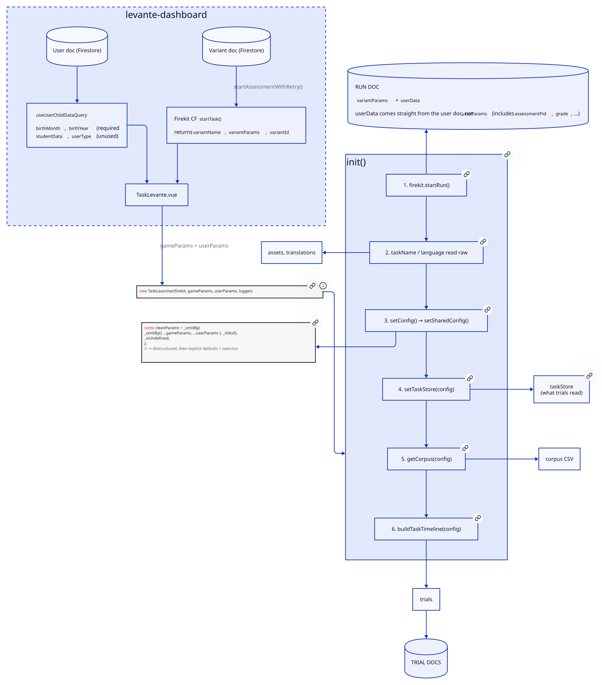
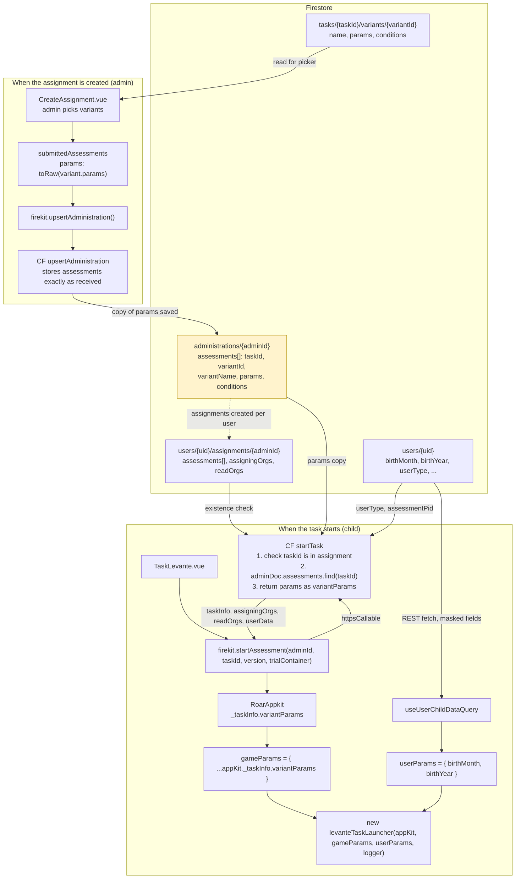
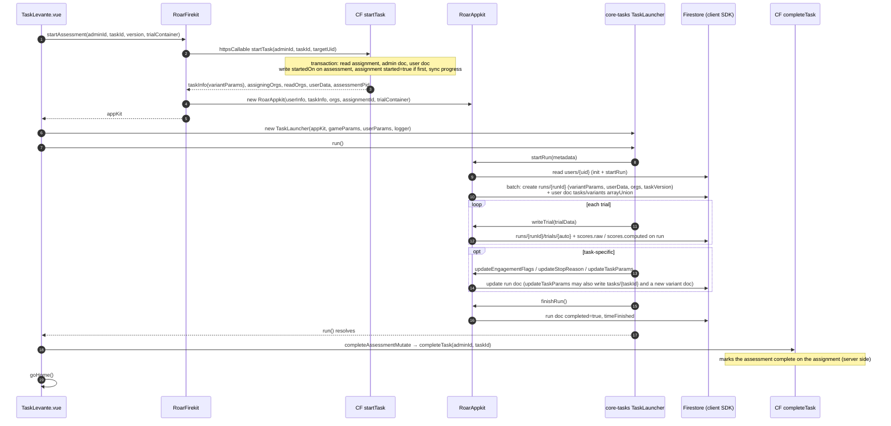

# Core-tasks launch parameter assessment

## Flow of params

Source: [diagrams/launch-params-flow.d2](diagrams/launch-params-flow.d2). Open the SVG directly to click nodes through to the code. Re-render with `d2 diagrams/launch-params-flow.d2 diagrams/launch-params-flow.svg`.

## How variant params get from the variant doc to the task launcher

## What firekit does

For each parameter core-tasks takes at launch: whether the task needs it to load, whether it's used after load, whether it reaches Firestore (run doc or trial doc), and where it comes from.

**Scope**
- **Code:** core-tasks `origin/main` at `14a6c1ee` (v1.3.22). I traced each parameter from `levante-dashboard` (`src/components/tasks/TaskLevante.vue`) through `TaskLauncher` (`task-launcher/src/index.ts`) and `setSharedConfig` (`task-launcher/src/tasks/shared/helpers/config.ts`) to every place it's used. Firestore writes are traced through firekit 9.7.0.
- **Data:** the **91 registered** core-tasks variants in **dev** (`hs-levante-admin-dev`), from a read-only scan of `tasks/{taskId}/variants/{variantId}` on 2026-10-29. The Create Assignment page only lists registered variants (`levante-dashboard/src/pages/CreateAssignment.vue`), so these are the ones that can be assigned. Unregistered variants and prod are out of scope.

## How parameters reach the task

- **`gameParams`**: the variant doc's `params` map, passed in unchanged (`gameParams = { ...appKit._taskInfo.variantParams }`).
- **`userParams`**: only `{ birthMonth, birthYear }`, read from the user doc by the dashboard. The dashboard won't launch a task until both are present.
- **Merge:** `setSharedConfig` merges them as `{ ...gameParams, ...userParams }` and then drops null and undefined values. So user params win over variant params, and a null value in a variant is the same as the key being absent.
- **What core-tasks sees:** only the keys destructured in `setSharedConfig` (plus `taskName`, `language` and `demoMode`, which `index.ts` reads directly). Any other variant key is ignored.
- **Run doc:** firekit's `startRun` copies the **entire** variant params object into `variantParams`. Every key in the variant ends up in every run doc, used or not. The run doc's `userData` (`birthMonth`, `birthYear`, `assessmentPid`, `grade`, `schoolLevel`, `assessmentUid`) is read by firekit straight from the user doc, not from `userParams`.
- **Trial docs:** the config is not saved. Only these parameter-derived fields end up on trials: `corpus` (2AFC and SDS trials), `corpusId` and `itemId` (only when `storeItemId` is true), and `inputType` (worked out from the device).
- **No real validation:** core-tasks only coerces values and fills in defaults. Only `taskName` and `language` are needed for a task to load.

## Parameter table

Unless a row says otherwise, the source is the variant doc. In the Firestore column, "run" means the parameter is saved in the run doc's `variantParams` whenever the variant sets it. The **Registered dev variants** column counts how many of the 91 have the key with a non-null value, and which values appear.

| Param | Source / default | Needed to load? | Used after load? | Firestore | Registered dev variants | Notes |
|---|---|---|---|---|---|---|
| `taskName` | variant | **Yes**: the task config lookup and bucket names crash without it | Yes (`config.task`, logging) | run | 91, all valid | The `'egma-math'` default in config is unreachable because `init()` has already crashed |
| `language` | variant | **Yes**: an undefined audio bucket makes `getMediaAssets` throw | Load only (asset and translation paths) | run | 91. **27 use 2-letter codes** (`en` 10, `es` 10, `de` 7). Others: `es-AR`, `nl-NL`, `en-GB`, `es-PE` (11 each), `pt-BR` 6, `en-US` 5, `de-DE` 5, `es-CO` 3, `fr-CA` 1 | `config.language` is never read. 2-letter codes are mapped (`es` → `es-CO`, `en` → `en-US`, `de` → `de-DE`) only in `index.ts`. The `i18next` fallback is unreachable |
| `corpus` | variant, falling back to the hard-coded `defaultCorpus` map | No | Yes (corpus CSV filename) | run + **trial** | 69. 22 null, so they use the default | Ignored by hearts-and-flowers, memory-game and intro (`index.ts` skips `getCorpus` for them) |
| `birthMonth` / `birthYear` | user doc via `userParams` | Dashboard requires them; core-tasks doesn't | Yes, used to compute age | run `userData` (firekit reads them itself) | n/a | |
| `age` | variant | No | Yes, overrides the computed age | run | 0 (49 have `age: null`) | Not set on any registered variant, but a non-null value would override the age of every child assigned that variant. With no age at all, age is `NaN`: heavy instructions are off, but memory-game still uses the young-child settings (4 blocks, 2x2 grid) |
| `userMetadata` | variant | No | Only passed to `firekit.updateUser` | none | 0 | `updateUser` only writes these fields for guest users, so this does nothing in Levante |
| `pid` | serve.js URL only | No | **No** | none | 0 | Never copied into config, so `assessmentPid` is always a random `makePid()` value |
| `maxTime` | 100 (minutes) | No | Yes (app timer, time-left check before each stimulus, CAT block time budgets) | run | 91: 4 (24), 6 (20), 8 (17), 100 (16), 15 (14) | |
| `maxIncorrect` | 3 | No | Yes (2AFC, SDS, hearts-and-flowers, memory-game, roar-inference) | run | 55: 3 (38), **100** (16: hearts-and-flowers 9, theory-of-mind 7), 10 (1) | 100 is used to switch the rule off |
| `cat` | false | No | Yes (becomes `runCat`; picks the CAT timeline and drives theta updates) | run | 73, 57 true | |
| `semThreshold` | `Number(undefined)` = NaN | No | Yes, CAT early stop (mental-rotation, vocab, TROG, matrix-reasoning) | run | 48, **all 0** | With 0 or NaN, CAT never stops early |
| `startingTheta` | NaN, turned into 0 | No | Yes, CAT initial theta | run | 63, all 0 | Same as the default |
| `heavyInstructions` | false, also forced on when age ≤ 4 | No | Yes (SDS, math, matrix-reasoning, hearts-and-flowers, memory-game) | run | 56, 1 true (hearts-and-flowers) | |
| `experimenterButtons` | **true** unless set to `false` (changed in #583) | No | Yes, but only when heavy instructions are active (age ≤ 4 or `heavyInstructions`) | run | 11, all true | Since #583 these are redundant: true is now the default. No registered variant sets `false` |
| `version` (`taskVersion` is a deprecated alias) | 1 | No | Yes, v2 feature flags in hearts-and-flowers, theory-of-mind, mental-rotation and SDS | run | `version` 21: mental-rotation 8, theory-of-mind 7 (all the string `"2"`), SDS 4, hearts-and-flowers 2. **`taskVersion` 12**: hearts-and-flowers 7 (six `2`, one `1`), SDS 5 | No variant sets both. Strings work because config runs `Number()`. Easy to confuse with the run doc's `taskVersion`, which is the core-tasks package version |
| `numberOfStories` | 3 | No | theory-of-mind v2 only | run | 0 | Always the default |
| `bubblePractice` | false | No | intro only | run | 0 | Intro bubble practice never runs from a registered variant |
| `buttonLayout` | `'default'` | No | Yes, `'diamond'` layout in 2AFC, math slider and roar-inference | run | 91, all `default` | The `'diamond'` path isn't used by any registered variant |
| `audioFeedback` | `'neutral'` | No | Yes, `'binary'` plays coin/fail sounds (mental-rotation, SDS, math, matrix-reasoning) | run | 0 | Always neutral |
| `sequentialStimulus` | true | No | Yes, `false` shuffles the corpus | run | 91, all true | The shuffle path isn't used by any registered variant |
| `storeItemId` | false | No | Yes, adds `corpusId` and `itemId` to trials | run + **trial** | 89, **42 true** (vocab, SDS, egma-math, mental-rotation, matrix-reasoning, trog) | `corpusId` is never set anywhere, so those 42 variants write `corpusId: undefined` on every trial |
| `demoMode` | false (serve.js: `DEMO` build flag) | Changes load: skips `startRun` | Yes, blocks all Firestore writes | none if true | 0 | If someone sets it in a variant, no data is saved and nothing warns |
| `debug` | false | No | Yes, shows CAT theta on screen | run | 0 | |
| `showAudioKeys` | false | No | Yes, shows audio keys on screen | run | 0 | |
| `keyHelpers` | false | No | roar-inference only | run | 90, 16 true (hearts-and-flowers 9, memory-game 7) | Neither of those tasks reads it, so it has no effect. No roar-inference variant is registered |
| `stimulusBlocks` | 3 | No | roar-inference only | run | 50, all 3 | No effect (no registered roar-inference variant) |
| `inferenceNumStories` | undefined | No | roar-inference only | run | 0 (17 have it as null) | |
| `sequentialPractice` | true | No | **No** (dead) | run | 91 | |
| `numberOfTrials` | 300 | No | **No** (dead) | run | 83 | |
| `numOfPracticeTrials` | 2 | No | **No** (dead) | run | 64 | |
| `skipInstructions` | false | No | **No** (dead; a code comment says so) | run | 59 | |
| `_isPaused` | none | No | **No**; `isPaused` is hard-coded to false | run | 0 | |

### In registered variants but not read by core-tasks

- `validUserTypes`: 8 survey variants (child-survey 7, adult-reasoning 1). Its type isn't consistent: `["student"]` (5), `"student"` (2), `["parent"]` (1). Neither core-tasks nor the dashboard front end reads it, so the backend may. Check before touching it.

### Computed or hard-coded, not passed in

- **`isRoarApp`**: set from the firekit project ID. Legacy ROAR; only changes how trials are saved.
- **`isDev`**: set from the firekit project ID, or from `demoMode` when there's no firekit.
- **`startTime`**: set in config but never read.

## Candidates for the refactor ticket

1. **Remove the dead parameters**:
   - From the code: `sequentialPractice`, `numberOfTrials`, `numOfPracticeTrials`, `skipInstructions`, `_isPaused`, `pid`, `userMetadata`, `startTime`, and `corpusId` (or actually populate `corpusId`, since 42 registered variants write it as undefined).
   - From registered variants: `sequentialPractice` (91), `numberOfTrials` (83), `numOfPracticeTrials` (64), `skipInstructions` (59). Every run doc copies them.
2. **Decide on the roar-inference-only parameters**: `keyHelpers`, `stimulusBlocks`, `inferenceNumStories`. No registered variant is for roar-inference, but they're on most registered variants.
3. **Migrate values before simplifying the code**:
   - `language`: rewrite the 27 two-letter codes, then remove the mapping in `index.ts`.
   - `taskVersion`: move the 12 hearts-and-flowers/SDS variants to `version`, then remove the alias. Removing the alias first would silently turn v2 off for them.
   - `version`: store the 7 theory-of-mind values as numbers rather than strings.
   - `experimenterButtons: true`: redundant since #583. It can be dropped from the 11 variants.
4. **Decide which parameters a variant should be allowed to set**:
   - `age` and `demoMode` aren't used by any registered variant, and both are risky in a variant. Consider blocking them.
   - These are set by every registered variant that has them, but always to the default, so they could go from variants: `semThreshold` (all 0), `startingTheta` (all 0), `buttonLayout` (all `default`), `sequentialStimulus` (all true). Check whether anyone plans to use the non-default paths.
5. **Validate the two required parameters at variant creation**: every registered variant is valid today, but nothing stops a bad `taskName` or `language` from being saved.
6. **Fix the bad defaults**: `semThreshold` and age both end up as NaN when not set.

## Not verified

- **Firekit version:** firekit behaviour comes from 9.7.0 (installed in core-tasks). The dashboard depends on `^9.7.2`, which isn't installed locally.
- **The `startAssessment` cloud function** is assumed to return the variant doc's `params` unchanged. Its code is in the backend repo.
- **Existing assignments** may still point at unregistered variants. Those are out of scope here.
