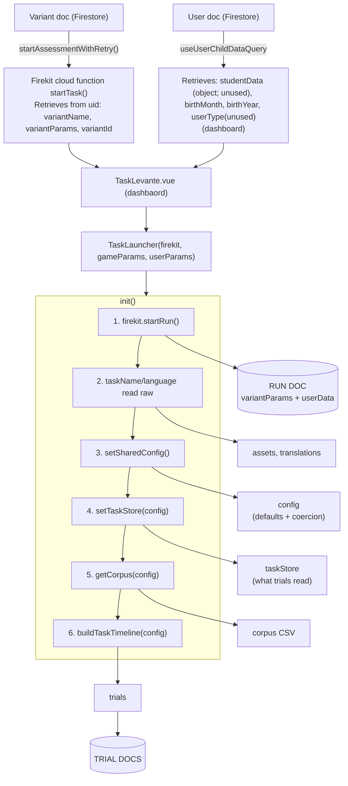
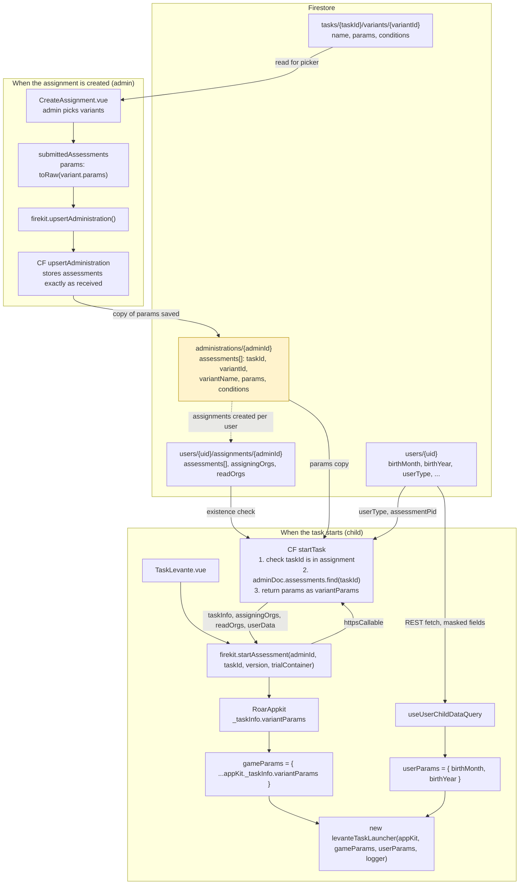
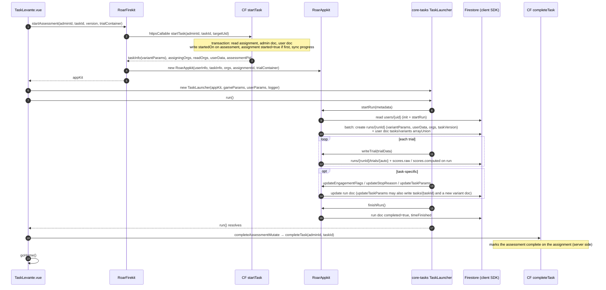

# Core-tasks launch parameter assessment

## Flow of params

## How variant params get from the variant doc to the task launcher

## What firekit does

Code-side inventory of every parameter core-tasks reads at launch. Traced from `levante-dashboard` (`TaskLevante.vue`) through `TaskLauncher` (`task-launcher/src/index.ts`) and `setSharedConfig` (`task-launcher/src/tasks/shared/helpers/config.ts`) to each place the value is used, and through firekit 9.7 to what gets written to Firestore. Based on core-tasks `main` at `3caf4fc2`.

The [Firestore inventory](#firestore-inventory-dev) section compares the table with the keys that actually exist in variant docs. That inventory covers **dev only** (`hs-levante-admin-dev`). Prod and the variant param spec catalog haven't been checked yet.

## How parameters reach the task

- **`gameParams`**: the variant doc's `params` map, passed in unchanged (`appKit._taskInfo.variantParams`).
- **`userParams`**: only `{ birthMonth, birthYear }`, read from the user doc by the dashboard. The dashboard won't launch a task until both are present.
- **Run doc**: firekit's `startRun` copies the whole variant params object into `variantParams`. Every key in the variant ends up in every run doc, used or not. The run doc's `userData` (`birthMonth`, `birthYear`, `assessmentPid`, `grade`, `schoolLevel`, `assessmentUid`) is read by firekit straight from the user doc, not from the params.
- **Trial docs**: the config is not saved. Only these parameter-derived fields end up on trials: `corpus` (2AFC and SDS trials), `corpusId` and `itemId` (only when `storeItemId` is true), and `inputType` (worked out from the device).
- **No real validation**: core-tasks only coerces values and fills in defaults. Only `taskName` and `language` are needed for a task to load.

## Parameter table

Unless a row says otherwise, the source is the variant doc, and "run doc" means the parameter is saved in the run doc's `variantParams` if it's set in the variant.

| Param | Source / default | Needed to load? | Used after load? | Firestore | Notes |
|---|---|---|---|---|---|
| `taskName` | variant | **Yes**: the task config lookup and bucket names crash without it | Yes (`config.task`, logging) | run | The `'egma-math'` default in config is unreachable because `init()` has already crashed |
| `language` | variant | **Yes**: an undefined audio bucket makes `getMediaAssets` throw | Load only (asset and translation paths) | run | `config.language` is never read. 2-letter codes are mapped to full codes (`es` → `es-CO`, etc.) only in `index.ts`. The `i18next` fallback is unreachable |
| `corpus` | variant, falling back to the hard-coded `defaultCorpus` map | No | Yes (corpus CSV filename) | run + **trial** | Ignored by hearts-and-flowers, memory-game and intro |
| `birthMonth` / `birthYear` | user doc via `userParams` | Dashboard requires them; core-tasks doesn't | Yes, used to compute age | run `userData` (firekit reads them itself) | |
| `age` | variant (real docs have `age: null`) | No | Yes, overrides the computed age | run | A non-null `age` in a variant overrides the age of every child assigned that variant. With no age at all, age is `NaN`: heavy instructions are off, but memory-game still uses the young-child settings (4 blocks, 2x2 grid) |
| `userMetadata` | variant | No | Only passed to `firekit.updateUser` | none | `updateUser` only writes these fields for guest users, so this does nothing in Levante |
| `pid` | serve.js URL only | No | **No** | none | Never copied into config, so `assessmentPid` is always a random `makePid()` value |
| `maxTime` | 100 (minutes) | No | Yes (app timer, time-left check before each stimulus, CAT block time budgets) | run | |
| `maxIncorrect` | 3 | No | Yes (2AFC, SDS, hearts-and-flowers, memory-game, roar-inference) | run | |
| `cat` | false | No | Yes (becomes `runCat`; picks the CAT timeline and drives theta updates) | run | |
| `semThreshold` | `Number(undefined)` = NaN | No | Yes, CAT early stop (mental-rotation, vocab, TROG, matrix-reasoning) | run | With NaN, the CAT never stops early |
| `startingTheta` | NaN, turned into 0 | No | Yes, CAT initial theta | run | |
| `heavyInstructions` | false, also forced on when age ≤ 4 | No | Yes (SDS, math, matrix-reasoning, hearts-and-flowers, memory-game) | run | |
| `experimenterButtons` | false | No | Yes, but only when heavy instructions are active | run | |
| `version` (`taskVersion` is a deprecated alias) | 1 | No | Yes, v2 feature flags in hearts-and-flowers, theory-of-mind, mental-rotation and SDS | run | Easy to confuse with the run doc's `taskVersion`, which is the core-tasks package version |
| `numberOfStories` | 3 | No | theory-of-mind v2 only | run | |
| `bubblePractice` | false | No | intro only | run | |
| `buttonLayout` | `'default'` | No | Yes, `'diamond'` layout in 2AFC, math slider and roar-inference | run | |
| `audioFeedback` | `'neutral'` | No | Yes, `'binary'` plays coin/fail sounds (mental-rotation, SDS, math, matrix-reasoning) | run | |
| `sequentialStimulus` | true | No | Yes, `false` shuffles the corpus | run | |
| `storeItemId` | false | No | Yes, adds `corpusId` and `itemId` to trials | run + **trial** | `corpusId` is never set anywhere, so it is always undefined |
| `demoMode` | false (serve.js: `DEMO` build flag) | Changes load: skips `startRun` | Yes, blocks all Firestore writes | none if true | If someone sets it in a variant, no data is saved and nothing warns |
| `debug` | false | No | Yes, shows CAT theta on screen | run | |
| `showAudioKeys` | false | No | Yes, shows audio keys on screen | run | |
| `keyHelpers` | false | No | roar-inference only | run | Legacy ROAR |
| `stimulusBlocks` | 3 | No | roar-inference only | run | Legacy ROAR |
| `inferenceNumStories` | undefined | No | roar-inference only | run | Legacy ROAR |
| `sequentialPractice` | true | No | **No** (dead) | run | |
| `numberOfTrials` | 300 | No | **No** (dead) | run | |
| `numOfPracticeTrials` | 2 | No | **No** (dead) | run | |
| `skipInstructions` | false | No | **No** (dead; a code comment says so) | run | |
| `_isPaused` | none | No | **No**; `isPaused` is hard-coded to false | run | |

### Computed or hard-coded, not passed in

- **`isRoarApp`**: set from the firekit project ID. Legacy ROAR; only changes how trials are saved.
- **`isDev`**: set from the firekit project ID, or from `demoMode` when there's no firekit.
- **`startTime`**: set in config but never read.

## Firestore inventory (dev)

Read-only scan of every `tasks/{taskId}/variants/{variantId}` doc in `hs-levante-admin-dev`, run 2026-10-29. There are 1,770 variant docs with 52 distinct `params` keys. **1,712** of those docs belong to core-tasks tasks, and all counts below are for those 1,712 only. The other docs (ROAR `pa`/`sre`/`swr`, caregiver/teacher surveys, MEFS, e2e test tasks) are out of scope.

**Caveats:**
- Only **91** of the 1,712 core-tasks variants are `registered: true` (73 are `false`, 1,548 have no flag). The Create Assignment page lists only registered variants (`levante-dashboard/src/pages/CreateAssignment.vue`), so registered means "can be assigned now". Existing assignments may still point at unregistered variants.
- Dev has a lot of test data. Prod still needs the same scan before anything is removed (waiting on prod access).

### Registered variants (the 91 that can be assigned)

None of the load-breaking or risky values below appear in the registered variants. All 91 have a valid `taskName` and `language`, `age` is null in every one, all `startingTheta` values are 0, and all `buttonLayout` values are `default`. Everything in the later subsections that's labelled a problem comes from unregistered or test variants.

What the registered variants do show:

| Finding | Detail | Why it matters |
|---|---|---|
| 2-letter `language` codes are still common | 27 of 91 (`es` 10, `en` 10, `de` 7) | The mapping in `index.ts` can't be removed until these are rewritten |
| `taskVersion` (deprecated alias) is in use | 11 variants: hearts-and-flowers (6× `2`, 1× `1`), SDS (5× `2`). No variant sets both `version` and `taskVersion` | Dropping the alias would silently turn off v2 for these variants. Migrate them to `version` first |
| `version` is stored as a string on theory-of-mind | All 7 ToM variants have `"2"` | Works because config runs `Number()`. Breaks if that coercion is removed |
| `storeItemId: true` | 42 variants (vocab, SDS, egma-math, mental-rotation, matrix-reasoning, trog) | Those runs write `corpusId: undefined` on every trial |
| `maxIncorrect: 100` | 16 variants (hearts-and-flowers 9, theory-of-mind 7) | Used to switch the stopping rule off |
| `keyHelpers: true` | 16 variants (hearts-and-flowers 9, memory-game 7) | Neither task reads it, so it has no effect |
| `experimenterButtons: true` | 11 variants, but only 1 has `heavyInstructions: true` | The buttons only show for children aged 4 or under in the other 10 |
| `cat: true` | 57 of 73 that set it | `semThreshold` is 0 in all 48 that set it, so CAT early stopping never fires |
| `corpus` null | 22 | They rely on the `defaultCorpus` fallback |
| Dead parameters | `sequentialPractice` 91, `numberOfTrials` 83, `numOfPracticeTrials` 64, `skipInstructions` 59, `inferenceNumStories` 17 (always null) | Present only because variants are copied from older ones |
| `validUserTypes` | 8 survey variants, mixed types (array `["student"]` vs. string `"student"`) | Not read by core-tasks. The backend may read it, so check before touching it |

The subsections below cover **all** 1,712 core-tasks variants, registered or not.

### Variants that would fail to load

These break the two parameters the code actually requires (`taskName`, `language`). **None of them are registered.**

| Problem | Variants | Effect |
|---|---|---|
| `taskName` missing | 3 (egma-math ×2 "Adaptive en", hearts-and-flowers "en-US H&F v2") | Task config lookup crashes |
| `taskName: 'TROG'` (uppercase) | 1 (trog `wCU3u01Jbw3yqpN6fsDL`) | Not a key in `taskConfig`, so the lookup crashes |
| `language` null | 7 (one each in egma-math, hearts-and-flowers, matrix-reasoning, memory-game, mental-rotation, theory-of-mind, trog) | Audio bucket path contains `undefined`, so `getMediaAssets` throws |
| `language` not one of the mapped codes | `es-co` ×20, `en-us` ×2, `es-Ar` ×1, plus junk (`d` ×3, `co` ×2, `esz`, `de=`, and random strings ×3) | Only `es`/`en`/`de` get mapped. Other values are used as-is in the asset folder path and will probably fail if that folder doesn't exist (not verified against the buckets) |

### How the code-side parameters are set in dev

"Set" means the key exists with a non-null, non-empty value.

| Param | Set in | Values seen | What it means |
|---|---|---|---|
| `language` | 1,705 | 1,583 use 2-letter `en`/`es`/`de` | Most variants depend on the 2-letter mapping in `index.ts` |
| `corpus` | 1,162 | 549 null or missing | Those fall back to `defaultCorpus` |
| `age` | 24 | 1, 5, 6, 10, 15, 30, 60 | Overrides the child's real age. Found in memory-game (12), SDS (6), hearts-and-flowers (4), egma-math (2) |
| `maxTime` | 903 | Mostly 100; also 1–30 | Null in 807, which falls back to 100 |
| `maxIncorrect` | 986 | 3, 6, 10, plus 100 / 1000 / 100000 | Very large values are used to switch the rule off. 101 values are stored as strings |
| `cat` | 991 | 344 true | |
| `semThreshold` | 892 | 0, 0.5, up to 4, plus `1e-08` | 11 stored as strings |
| `startingTheta` | 634 | Mostly 0; also −10 to 1, and **200000000** (2 matrix-reasoning variants) | |
| `heavyInstructions` | 666 | 84 true | |
| `experimenterButtons` | 13 | | |
| `buttonLayout` | 1,061 | `default`, `diamond` (174), `triple` (14), `grid` (2), junk (`evbzbae`, `diamondtrials=200`) | Code only checks for `'diamond'`, so everything else acts as default |
| `storeItemId` | 1,671 | 81 true | Those 81 variants write `corpusId: undefined` on every trial |
| `sequentialStimulus` | 1,711 | 81 false | |
| `version` / `taskVersion` | 22 / 14 | 2 (7 stored as the string `"2"`), 1 | Strings are fine because config runs `Number()` |
| `keyHelpers`, `stimulusBlocks` | 1,710 / 918 | | Only roar-inference reads these, and dev has 2 roar-inference variants |
| `inferenceNumStories` | 2 | 19 | Both are egma-math variants, which don't read it |

**Read by the code but never set in any dev variant** (always the default):
- `audioFeedback`: the `'binary'` coin/fail sounds are never on. A different key, `audioFeedbackOption`, exists only on ROAR `swr` variants.
- `bubblePractice`: intro bubble practice never runs from a variant.
- `numberOfStories`: theory-of-mind v2 always uses 3.
- `demoMode`, `debug`, `showAudioKeys`, `_isPaused`.

**Dead parameters that are nearly everywhere** (and copied into every run doc):
- `sequentialPractice`: 1,711 variants
- `skipInstructions`: 1,669
- `numberOfTrials`: 1,024 set, 1,701 present
- `numOfPracticeTrials`: 954 set, 1,667 present

**Keys in core-tasks variants that core-tasks never reads:**
- `numItemsPerStory` and `numStories`: 18 variants (`numStories` always null).
- `validUserTypes`: 8 adult-reasoning/child-survey variants. Not read by core-tasks or the dashboard front end, so the backend may be using it. Check before removing.
- `ageInMonths` (3), `researcherName` (2, always null).
- 8 hearts-and-flowers timing keys on a single variant (`stimulusPresentationTime*`, `interStimulusInterval`, `testTrialCount*`, `practiceWinStreak*`).

## Candidates for the refactor ticket

1. **Remove the dead parameters**:
   - From the code: `sequentialPractice`, `numberOfTrials`, `numOfPracticeTrials`, `skipInstructions`, `_isPaused`, `pid`, `userMetadata`, `startTime`, and `corpusId` (or actually populate `corpusId`).
   - From variant docs: the dead keys above, plus the unread keys (after checking `validUserTypes`).
2. **Decide on the roar-inference-only parameters**: `keyHelpers`, `stimulusBlocks`, `inferenceNumStories`. They're on nearly every variant, but only 2 roar-inference variants exist in dev.
3. **Clarify what belongs in a variant doc**:
   - `age`: 24 dev variants hard-code a child age (none registered).
   - `demoMode`: not used by any variant in dev, so it can safely be blocked there.
   - `language`: 27 of the 91 registered variants still use 2-letter codes, and 33 unregistered ones have malformed values. Normalize the stored values, then remove the mapping.
   - `taskVersion`: 11 registered hearts-and-flowers/SDS variants still use the deprecated alias. Migrate them to `version` before removing it.
   - Every run doc copies all of these dead parameters.
4. **Validate the two required parameters at variant creation**: 11 dev variants would fail to load because of a bad `taskName` or `language`. None are registered, so this is about preventing it, not about current breakage.
5. **Fix the bad defaults and types**: `semThreshold` and age both end up as NaN. Many numeric parameters are stored as strings. There are junk `buttonLayout` values and an extreme `startingTheta`.
