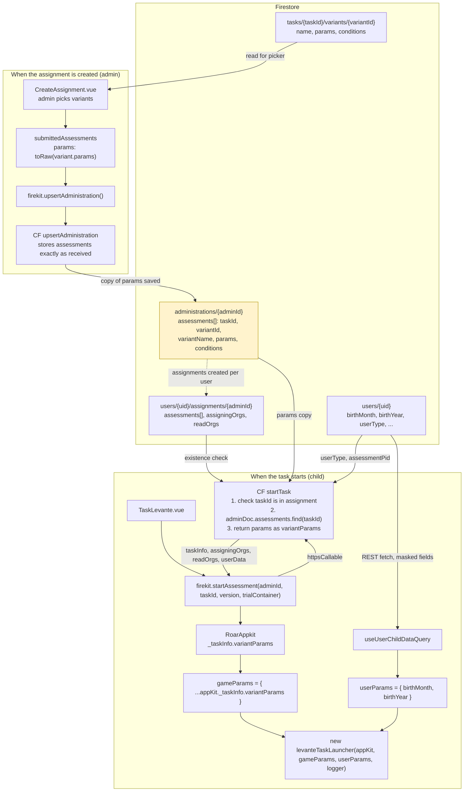

# How variant params get from the variant doc to the task launcher

Part of the [launch parameters assessment](../launch-params-assessment.md). The administration doc (highlighted) holds the copy of the variant's params that `startTask` returns at launch, so editing a variant later doesn't change assignments that already exist.

