# Hearts and Flowers (`heartsAndFlowers`)

Timeline source: `src/tasks/hearts-and-flowers/`. See the [README](README.md) for the legend and shared conventions.

## Corpus-driven structure

Only the opening screens (input instructions and the two button demos) and the end screen are fixed in code. Everything in between is built from the corpus, **one row per screen or trial, in corpus order**:

| Row | `assessment_stage` | `trial_type` | Becomes |
|---|---|---|---|
| Instruction screen | `instructions` | `instructions` | One screen, with the audio named by `audio_file` |
| Instruction practice | `instructions` | `hearts` or `flowers` | One stimulus on a fixed side that repeats until answered correctly |
| Practice trial | `practice_response` | `hearts`, `flowers` or `hearts and flowers` | Fixation → stimulus → feedback |
| Test trial | `test_response` | `hearts`, `flowers` or `hearts and flowers` | Fixation → stimulus, timed by the row's `time_limit` |

Consecutive practice or test rows with the same `block_index` form one block. The stimulus (for mixed blocks) and its side are balanced across the block, not set per row.

The chart shows the order in the current corpus. Reordering or adding rows in the corpus changes the flow without a code change.

```mermaid
flowchart TD
    START([START]) --> IN[Input instructions] --> LB[Left button demo] --> RB[Right button demo]
    RB --> HB

    subgraph HEARTS["Hearts (press SAME side)"]
        HB[Intro screen] --> HIP1["Instruction practice 1"]
        HIP1 --> HC1{Correct?}
        HC1 -- no: try again --> HIP1
        HC1 -- yes --> HIP2["Instruction practice 2"]
        HIP2 --> HC2{Correct?}
        HC2 -- no: try again --> HIP2
        HC2 -- yes --> HTTP[Practice-time screen]
        HTTP --> HPR["Practice trials: fixation → stimulus → feedback"]
        HPR --> HS{"Correct streak<br/>reached?"}
        HS -- yes: end practice early --> HPOST
        HS -- no, trials left --> HPR
        HS -- no, trials done --> HPOST[Transition screens]
        HPOST --> HT["Test trials: fixation → stimulus<br/>(timed)"]
    end

    HT --> FB

    subgraph FLOWERS["Flowers (press OPPOSITE side)"]
        FB[Intro screen] --> FIP["Instruction practice 1, then 2<br/>each repeats until correct"]
        FIP --> FTTP[Practice-time screen] --> FPR["Practice with feedback<br/>early exit on streak"]
        FPR --> FPOST[Transition screens]
        FPOST --> FT["Test trials"]
    end

    FT --> MB

    subgraph MIXED["Mixed (heart → same, flower → opposite)"]
        MB[Intro screen] --> MIP["Instruction practice: heart, then flower<br/>each repeats until correct"]
        MIP --> MTTP[Practice-time screen] --> MPR["Mixed practice with feedback<br/>early exit on streak"]
        MPR --> MPOST[Transition screens]
        MPOST --> MT["Mixed test trials"]
    end

    MT --> HEAVY{heavyInstructions?}
    HEAVY -- "yes: faster blocks<br/>removed from the corpus" --> ENDG

    subgraph FASTER["Faster mixed blocks"]
        GF["Going-faster screen → mixed test trials<br/>with a shorter time limit<br/>(repeated for each faster block)"]
    end

    HEAVY -- no --> GF
    GF --> ENDG[End screen] --> EXIT([Exit fullscreen])
```

Every test trial can also end the task early (see below).

## Rules set in code

- **Practice early exit:** a practice block ends once the child gets a streak right in a row: `PRACTICE_WIN_STREAK`, currently 2 for hearts and flowers and 3 for mixed.
- **`heavyInstructions`:** removes every row in the faster mixed blocks (`FASTER_MIXED_BLOCKS`, currently `block_index` 3 and 4) before the timeline is built. This is how a heavy run skips them.
- **Instruction-practice side:** fixed per `audio_file` (`INSTRUCTION_PRACTICE_SIDES`), because the prompt audio names the side.
- **Fixation:** lasts `INTER_STIMULUS_INTERVAL`, currently 500 ms.

## Trial timing

A test stimulus stays up for its row's `time_limit`. With no response, the trial is recorded as timed out and incorrect, and the task moves on. Practice and instruction-practice trials have no time limit and wait for a response.

## Early stop

After every trial, `shouldTerminateCat` checks the last 10 test trials. If **more than 6** are wrong, the task ends (`errorOut`).

- Only test trials count. Practice and instruction practice are excluded.
- The window spans blocks: it is the last 10 test trials overall, not per block.
- Timed-out trials count as wrong.
- Despite the name, this runs on every H&F run, not only in CAT mode. (The comment in `shouldTerminateCat.ts` says "4 of the last 10", but the code checks for more than 6.)

## Corpus checks

Before the timeline is built, each row group is checked. The task fails to start with a `Corpus validation failed` error if:

- the corpus has no test rows (missing or failed to load)
- a row has an unknown `assessment_stage` or `trial_type`
- an instruction row has no `audio_file`, or an instruction-practice row's `audio_file` has no fixed side
- the rows in one block have different `trial_type` values
- a test row has no positive `time_limit`

A missing translation for an instruction screen is logged, but the screen is still shown.

## Not CAT

H&F has no ability estimate or item selection. Trials run in corpus order, and the `cat` / `runCat` param has no effect on it. The only CAT-related piece is the early-stop rule above, which runs regardless.
