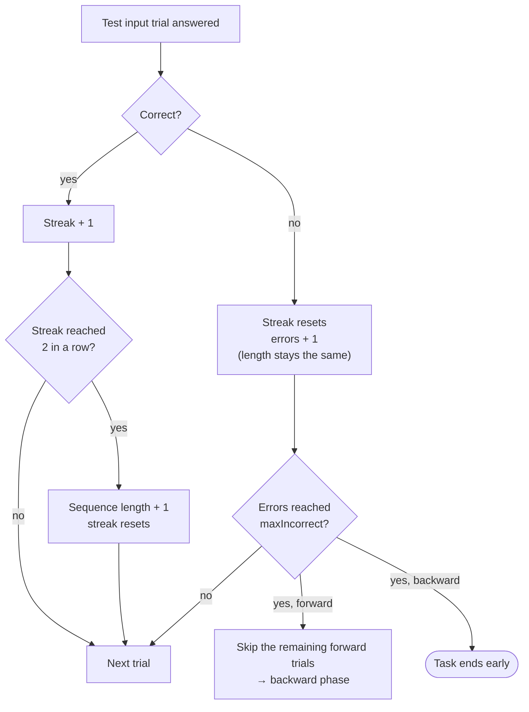

# Memory Game (`memoryGame`, Corsi blocks)

Timeline source: `src/tasks/memory-game/`. Corpus: `memory-game-item-bank`. See the [README](README.md) for the legend and shared conventions.

Each **trial** is a pair: a display trial (blocks light up in a random sequence), then an input trial (the child taps them back, in reverse order for backward trials). The sequence itself is always random and generated when the display trial starts. The corpus decides everything around it: the order of screens, how many practice and test trials there are, fixed practice lengths, cursor hints and audio cues (see "Corpus-driven structure").

## Set when the task starts

Two settings are fixed before the first screen. Both depend on the child's age (the `age` param, or the age from the birth month and year):

| Setting | Rule | Effect |
|---|---|---|
| **Instruction flow** | Heavy if the `heavyInstructions` variant param is on, **or** age ≤ 4 | Heavy: the corpus's downex rows, where a block has them. Otherwise: the main rows. |
| **Grid** | 3×3 (9 blocks) if age > 4, otherwise 2×2 (4 larger blocks) | Board size for the whole task, unless the fallback switches it |

That gives these starting combinations:

| | Grid | Instruction flow |
|---|---|---|
| age > 4 | 3×3 | default |
| age > 4, `heavyInstructions` on | 3×3 | heavy |
| age ≤ 4 | 2×2 | heavy (always) |
| age unknown | 2×2 | default, unless `heavyInstructions` is on |

The last row is a side effect: an unknown age is `NaN`, which is neither ≤ 4 nor > 4.

"Downex" (downward extension) is the same thing as the heavy flow: an easier version of the instructions and practice for younger children.

## Corpus-driven structure

The timeline is built from the corpus, **one row per screen or trial, in corpus order**. The corpus has two sets of rows: main rows (`downex` FALSE) and downex rows (`downex` TRUE). For each `block_index`, a heavy run uses that block's downex rows if it has any, and the main rows otherwise. A default run always uses the main rows.

| Row | `assessment_stage` | `trial_type` | Becomes |
|---|---|---|---|
| Instruction screen | `instructions` | `instructions` | One screen: `audio_file` (one key) plays, `image` (image or video) is shown |
| Practice trial | `practice_response` | `forward` or `backward` | Display → input → feedback. How a wrong answer is handled depends on the flow (see below). |
| Test trial | `test_response` | `forward` or `backward` | Display → input, no feedback. Moves the staircase. |

Other columns:

- **`item`:** a fixed sequence length for that trial. Blank uses the current staircase length.
- **`image` = `cursor`** (downex practice rows only): a guided trial. A cursor sits on the next block to press and the other blocks are disabled.
- **`audio_file`** on a trial row: `"display,input"`, the cues for the two screens. Blank uses the defaults: `memoryGameDisplay` (or `memoryGameInstruct7Downex` when `heavyInstructions` is on) for display, and `memoryGameInstruct8Downex` / `memoryGameInstruct11Downex` for forward / backward input. The on-screen text is the translation of that same key. The `prompt` column isn't read.

**Default practice:** consecutive practice rows with the same `trial_type` form one run, and each trial gets feedback. If the run's last answer is wrong, the whole run plays once more, and the last trial of the replay gets feedback only if it's correct. After a wrong answer, the feedback screen plays the row's input cue as the try-again prompt.

**Heavy practice:** each row is one trial. A correct answer gets feedback. A wrong one gets a single input-only retry with the next block pulsing, whose prompt is hardcoded (`memoryGameFeedbackIncorrectDownex` forward, `memoryGameInstruct11Downex` backward).

### Current corpus

| Block | Main rows (default flow) | Downex rows (heavy flow) |
|---|---|---|
| 0: forward instructions and practice | 4 instruction screens, then **2 practice trials** at the staircase length (2) | 1 screen, 2 practice trials at length 1 (1st guided), 1 screen, 2 practice trials at length 2 (1st guided): **4 practice trials** |
| 1: forward test | "Won't tell you if you're right" screen, then **14 test trials** | 3 screens (on your own / keep going / time to play), then **14 test trials** |
| 2: backward instructions and practice | 2 instruction screens, then **2 practice trials** at the staircase length | 1 screen, then **3 practice trials**: 1 guided at the staircase length, then 2 at length 2 |
| 3: backward test | "Won't tell you if you're right" screen, then **12 test trials** | Same screen, then **12 test trials** |

Display cues in the current test rows: in the main rows, the first 2 forward and first 2 backward trials use `memory-game-display` and the rest use `memory-game-instruct7-downex` ("Let's watch!"). Every downex test row uses `memory-game-instruct7-downex`.

### Corpus checks

The task fails to start with a `Corpus validation failed` error if:

- there are no test rows (the corpus is missing or failed to load)
- there are no downex forward practice rows to replay on fallback
- an instruction row has no `audio_file`, more than one, or an `image` that isn't a known image or video
- a row has an unknown `assessment_stage` or `trial_type`
- a row other than a downex practice row is guided (`image` = `cursor`)
- `item` isn't a positive whole number
- a trial row's `audio_file` isn't blank or exactly two keys

## Flow

This chart shows counts from the current corpus (see the table above), the 4 early trials (`FALLBACK_CHECK_TRIALS`) and the default `maxIncorrect` of 3. Update it when the corpus changes. A "trial" is one display + input pair.

The two `heavyInstructions?` diamonds are decided when the timeline is built. The fallback changes some settings while the task runs, but not which rows are played. At any point, reaching `maxTime` (default 100 minutes) or an experimenter exit ends the task.

```mermaid
flowchart TD
    START([START]) --> HV{"heavyInstructions?<br/>(param on, or age ≤ 4;<br/>set at start)"}

    HV -- no --> DEF_I["Instructions<br/>(4 screens)"]
    DEF_I --> DEF_P["Forward practice: 2 trials<br/>(display → input → feedback)"]
    DEF_P --> DEF_C{"2nd practice<br/>correct?"}
    DEF_C -- no --> DEF_P2["Replay both trials<br/>(feedback on the last one only if correct)"] --> RTP1
    DEF_C -- yes --> RTP1["'Won't tell you if you're right' screen"]

    HV -- yes --> DX["Downward-extension instructions and practice:<br/>intro screen → 2 trials at length 1<br/>→ 'now two squares' screen → 2 trials at length 2<br/>(cursor hint on the first trial of each length;<br/>each wrong answer → 1 retry with the next block pulsing)"]
    DX --> DXE["3 screens: play on your own →<br/>keep going if you make a mistake → time to play"]

    RTP1 --> F4
    DXE --> F4

    subgraph EARLY["Forward test trials 1–4"]
        F4["Forward trial<br/>(display → input)<br/>length starts at 2"] --> FBC{"Fallback check, at most once:<br/>last 2 trials both wrong?<br/>(can pass after trials 2, 3 or 4)"}
        FBC -- yes --> FALL["Switch to heavy mode and the 2×2 grid<br/>→ repeat-instructions message<br/>→ replay the downward-extension<br/>forward practice (4 trials, with retries)"] --> FWD
        FBC -- no --> F4N{"4 trials<br/>played?"}
        F4N -- no --> F4
    end

    F4N -- yes --> FWD["Forward test trials 5–14<br/>(length +1 after every 2 correct in a row;<br/>max length 8)"]
    EARLY -. "3rd error<br/>(earliest: trial 3)" .-> SKIPF["Remaining forward trials skipped"]
    FWD -. "3rd error" .-> SKIPF
    FWD -- "14 played" --> RESET
    SKIPF --> RESET["Before backward:<br/>errors reset to 0;<br/>length → 3 if the child got past length 3, else 2"]

    RESET --> HV2{"heavyInstructions?<br/>(set at start)"}
    HV2 -- no --> RP["2 instruction screens<br/>→ backward practice: 2 trials<br/>→ replay both if the 2nd is wrong"]
    HV2 -- yes --> RDX["1 instruction screen<br/>→ downward-extension backward practice:<br/>1 guided trial, then 2 at length 2<br/>(each wrong answer → 1 retry)"]
    RP --> RTP2["'Won't tell you if you're right' screen"]
    RDX --> RTP2
    RTP2 --> REV["Backward test trial<br/>(display → input, reversed answer;<br/>length +1 after every 2 correct in a row)"]
    REV --> ERR{"3rd backward<br/>error?"}
    ERR -- "yes (earliest: trial 3)" --> STOP(["Task ends early<br/>(errorOut)"])
    ERR -- "no, fewer than 12 played" --> REV
    ERR -- "no, 12 played" --> END([END])
```

Test trials played: forward 3–14, backward 3–12, whole task 6–26. A run counts as complete at 21 test trials (80% of 26). See the next section.

## Trial counts and when the task stops

Counts below are for the current corpus, with the error budget from the `maxIncorrect` variant param at its default of 3. A "trial" is one display + input pair.

### Per block

| Block | Default flow | Heavy flow |
|---|---|---|
| Forward practice | 2 trials with feedback. If the 2nd is wrong, both are replayed (the last gets feedback only if correct): **2 or 4** | 4 trials at lengths 1, 1, 2, 2. Each wrong answer adds one input-only retry with the next block pulsing: **4 trials, plus 0–4 retries** |
| Fallback replay (at most once, during the early forward trials) | the heavy forward practice: **4 trials, plus 0–4 retries** | same |
| Forward test | **at most 14**, at least 3 | same |
| Backward practice | 2 trials with feedback, both replayed if the 2nd is wrong: **2 or 4** | 3 trials (1 guided at the staircase length, then 2 at length 2), each with an optional retry: **3, plus 0–3 retries** |
| Backward test | **at most 12**, at least 3 | same |

Practice trials never count as test trials, toward the error budget, or toward completion.

### Maximum vs. early termination

| | Ends when | Test trials played |
|---|---|---|
| **Forward phase** | all 14 played, **or** the 3rd error (the remaining forward trials are skipped and backward starts) | 3–14 |
| **Backward phase** | all 12 played, **or** the 3rd error, which **ends the whole task** (`errorOut`) | 3–12 |
| **Whole task** | all trials done, the 3rd backward error, `maxTime` reached (default 100 minutes, `timeOut`), or the experimenter exits | **6–26** |

The minimum of 3 per phase means 3 wrong in a row. Errors are a running total, so a phase usually ends later than that, with some correct answers in between.

### Sequence lengths reached

- **Forward:** starts at 2 and goes up 1 after every 2 correct in a row. With all 14 correct, trials go 2, 2, 3, 3, … 8, 8, so the **maximum is 8**.
- **Backward:** starts at 3 if the child got past length 3 going forward, otherwise 2. With all 12 correct, the maximum is **8** from a start of 3, or **7** from a start of 2. It can be 1 higher if a forward streak carries over (see "How difficulty adapts").

### Completion

A run counts as complete (`recordCompletion`) once the test-trial count reaches **80% of 26**, so 21 test trials, whether or not the task ended early afterwards.

- If forward ends early on errors, the count jumps as if all forward trials had been played, so the child is still counted as complete after enough backward trials.
- **Counting bug:** the count is set to the number of forward trials (14), and then the trial that just ended is added, giving 15. So completion is reached one backward trial early (6 instead of 7).

## How difficulty adapts

Difficulty is the **sequence length** (how many blocks light up). It follows a simple staircase that **only goes up**, and it only changes on test trials. Practice trials never change the length or the error count.

- **Starting length:** 2 for forward. For backward: 3 if the child got past length 3 going forward, otherwise 2.
- **Errors are a running total, not consecutive.** A correct answer resets the streak but not the error count. The error count resets once, before the backward phase.
- **The streak is not reset before the backward phase.** If the forward phase ends partway through a streak, the first correct backward test trial raises the length.
- **`maxIncorrect`** is a variant param (default 3).
- **Practice uses the staircase length unless `item` is set.** Rows with a fixed `item` use that length. Rows without one, like the main practice rows and the guided heavy backward row, use the current length without changing it.

These rules live in the input trial's `on_finish` in `trials/stimulus.ts`.

## Fallback (switching to the heavy flow mid-task)

After each of the first 4 forward test trials (`FALLBACK_CHECK_TRIALS`), a check runs. It can pass at most once, and passes when **the last 2 forward answers were both wrong**. (`checkFallbackCriteria` reads the last 4 test-stage records, which are 2 display/input pairs, and counts wrong inputs.) So it can't pass after the first trial, only after the second, third or fourth. If it passes:

1. `heavyInstructions` turns on, and the grid switches to 2×2 with larger blocks for the rest of the task.
2. The repeat-instructions message plays, then the downex forward practice is replayed. That's the downex rows of its block, starting at the first practice row, so the intro screen is skipped.
3. The forward test trials continue on the smaller grid.

The fallback does **not** reset the error count or the sequence length. The 2 errors that triggered it still count toward `maxIncorrect`, so with the default of 3, one more forward error ends the forward phase.

The rows were picked when the timeline was built, so a child who falls back keeps playing the **main** rows: the main forward and backward test trials, and the default backward practice. Cues set in a row's `audio_file` don't change. Only blank cells switch to the heavy display cue, because the default checks `heavyInstructions` as each trial runs.

## Not CAT

Memory game does not use computerized adaptive testing:

- **CAT** (in tasks like math, matrix reasoning and vocab) keeps an ability estimate (theta) from an IRT model. It updates the estimate after each answer and picks the next corpus item by its calibrated difficulty, stopping once the estimate is precise enough.
- **Memory game** has no item difficulties, no ability estimate and no item selection. Sequences are random, the length follows the staircase above, and it stops on a fixed number of errors. The `cat` / `runCat` param has no effect on it.

The timeline does call `initializeCat()`, but nothing in memory game reads or updates the result.
